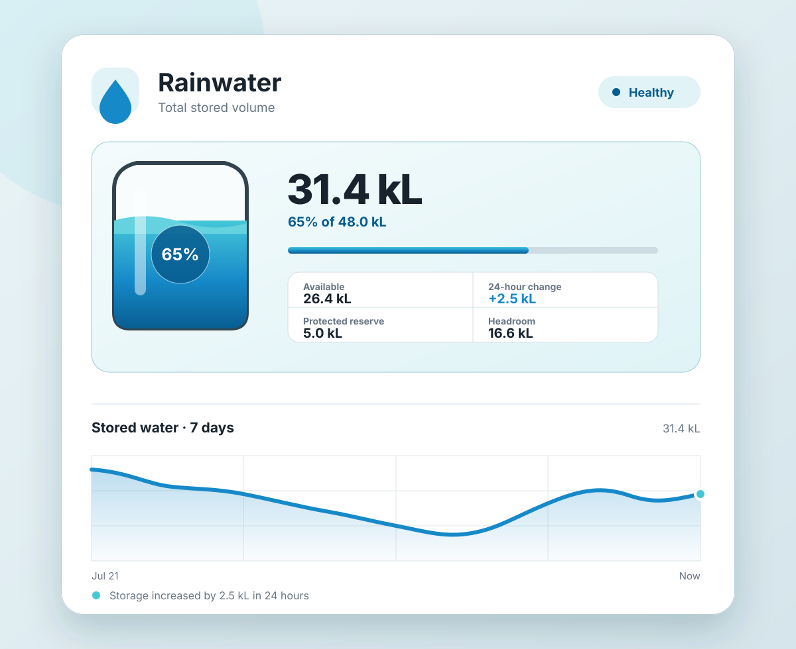

# Rainwater Card

A Home Assistant dashboard card for total stored rainwater, usable reserve,
remaining capacity, daily change, and volume history.

Available directly in the default HACS catalogue. Search for **Rainwater Card**
in HACS; no custom repository is needed.



## Highlights

- One required total-volume sensor.
- Configurable tank capacity and protected reserve.
- Daily change and inspectable history.
- Supports litres, kilolitres, cubic metres, and US or imperial gallons.
- Native Home Assistant visual configuration.

## Minimal configuration

```yaml
type: custom:rainwater-card
entity: sensor.total_water_volume
```

See the repository README for capacity, reserve, and history settings.

